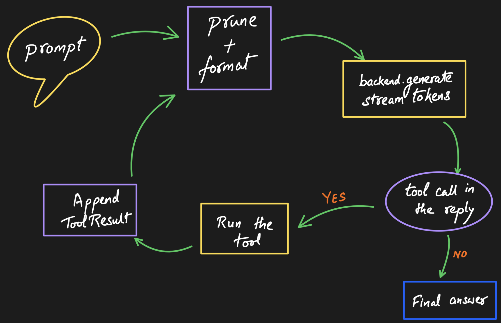

The `Agent` struct is the main entry point. It owns the conversation state and
drives the prompt → LLM → response loop.



*One call to `prompt` drives the whole cycle, looping on tool calls until the
model returns a tool-free answer (bounded by `max_tool_iterations`, default 8).*

## Creating an agent

```rust
use orion_core::{Agent, AgentConfig, InferenceParams, ContextConfig};

let mut agent = Agent::new(AgentConfig {
    system_prompt: "You are a coding assistant.".into(),
    inference_params: InferenceParams {
        max_tokens: 4096,
        temperature: 0.4,
        context_size: 8192,
        n_threads: 6,
    },
    context_config: ContextConfig {
        max_context_tokens: 8192,
        max_response_tokens: 4096,
        ..Default::default()
    },
    ..Default::default()
});
```

`AgentConfig` carries the system prompt, inference parameters, context
configuration, `max_tool_iterations` (the cap on tool-loop rounds, default 8),
and `pause_on_pending` (end the run with `Paused` when a turn leaves tool calls
pending, default off). Everything has a sensible `Default`, so `Agent::new(AgentConfig::default())`
is a valid starting point.

## Running a turn

There are three ways to drive a turn with new user text:

- **`agent.prompt(text, backend, tx)`** - you create the
  `mpsc::unbounded_channel::<AgentEvent>()` and pass the sender. The agent
  streams events into it and returns when the turn is done.
- **`agent.prompt_stream(text, backend)`** - the agent creates the channel for
  you and returns `(receiver, future)`. Drive the future while you drain the
  receiver.
- **`agent.send(text, backend)`** - for a caller that is not streaming. It runs
  the same turn, drains the events and answers with the final assistant
  message, turning an `Error` event into an `Err`.

And one way to drive a turn without it:

- **`agent.resume(backend, tx)`** - carries the conversation on from where it
  stands: after a tool result arrives through the inbox, after a pause, or after
  a restart. See [Long-running work](../long-running/).

All of them run the full context → generate → tool loop described in
[Architecture](../architecture/).

## Changing settings on the fly

```rust
agent.set_system_prompt("You are a pirate.");
agent.set_inference_params(InferenceParams { temperature: 1.2, ..Default::default() });
```

## Managing the conversation

```rust
agent.clear();                          // Reset the conversation
agent.replace_messages(saved_messages); // Restore a saved conversation
```

Because conversation state is just a `Vec<Message>`, you can persist it and
restore it later with `replace_messages` - useful for resuming sessions.

```rust
agent.inbox().push("Also check the README."); // reach the agent mid-run
agent.resume(backend, tx).await?;             // carry on without new user text
agent.pending_calls();                        // tool calls still owed a result
agent.needs_reply();                          // does the conversation end unanswered?
```

`resume` picks a restored conversation up where it stopped, including one saved
partway through a run. See [Long-running work](../long-running/).

## Stopping a run

```rust
agent.abort();
```

`abort` signals the shared `AtomicBool` the backend checks each token, so a
running generation stops promptly. The run records an empty assistant turn,
emits `AgentEnd` and returns `Ok(())`, not an [error](../errors/). If tools are
running, the round's remaining calls still run and the loop stops after it. Tools see the same flag through
`ToolContext::is_aborted`, and a child agent run with `ToolContext::run_child`
stops with its parent.

## Tools and templates

The agent also owns the registered tools and the active chat template:

- `agent.set_tools(vec![Box::new(MyTool)])` - see [Tools](../tools/).
- `agent.set_approval_hook(Arc::new(MyHook))` - authorize tool calls before they
  run; see [Gating tool calls](../tools/#gating-tool-calls).
- `Agent::with_template(config, template)` / `agent.set_template(template)` -
  see [Templates](../templates/).
