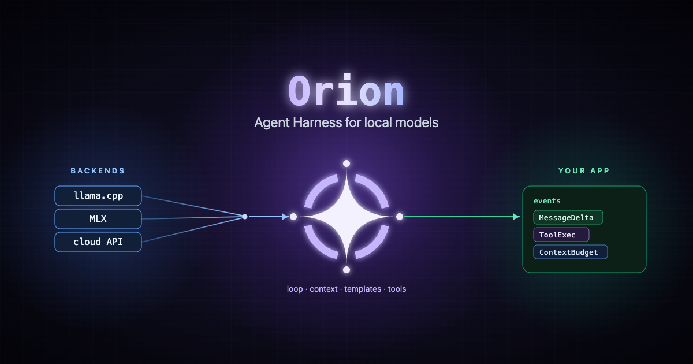

import { Card, CardGrid, LinkCard, Aside } from '@astrojs/starlight/components';

export const base = import.meta.env.BASE_URL;



**Agent harness for local LLM inference.** Backend-agnostic - bring your own
model runtime (llama.cpp, MLX, cloud APIs, anything).

Orion handles the conversation loop so you don't have to: context
management, token budgets, streaming events, chat formatting, and an automatic
tool-execution loop. You implement one backend trait for your inference
engine - `LlmBackend` for a local engine, `ChatBackend` for a hosted chat API -
and Orion handles everything above it.

## How it works

```text
User sends "Hello"
  → Agent.prompt("Hello")
    → Context pipeline (prune old messages to fit token budget)
      → Format prompt (ChatML template + tool definitions)
        → LlmBackend.generate() (streams tokens one by one)
          → AgentEvent stream (your UI subscribes here)
            → If the model called tools: run them, append results, loop back
              → Done (model returns a tool-free answer)

Agent.inbox() reaches the agent mid-run (read before every model call),
and Agent.resume() carries a conversation on without new user text.
```

<CardGrid>
  <LinkCard
    title="Getting started"
    description="Install the crate, wire up a backend, and run your first prompt."
    href={`${base}start/getting-started/`}
  />
  <LinkCard
    title="Implement a backend"
    description="The one trait you write: LlmBackend for a local engine, ChatBackend for a hosted API."
    href={`${base}concepts/backend/`}
  />
  <LinkCard
    title="Give the model tools"
    description="Define tools and let the agent run the call → execute → reply loop."
    href={`${base}concepts/tools/`}
  />
  <LinkCard
    title="Long-running work"
    description="Pending tool results, the inbox, resuming after a restart, and child agents."
    href={`${base}concepts/long-running/`}
  />
  <LinkCard
    title="Context & budgets"
    description="Pruning strategies, pinned messages, and token accounting."
    href={`${base}concepts/context/`}
  />
</CardGrid>

## What you get

<CardGrid>
  <Card title="One trait to implement" icon="seti:rust">
    Plug in a local engine by implementing `LlmBackend`, which runs on a
    blocking thread with no async required, or a hosted chat API with
    `ChatBackend`. Orion owns the async orchestration.
  </Card>
  <Card title="Streaming events" icon="random">
    Subscribe to an `AgentEvent` stream for tokens, tool execution, and
    context-budget updates - everything a reactive UI needs.
  </Card>
  <Card title="Automatic tool loop" icon="puzzle">
    The agent parses tool calls, runs your tools, feeds results back, and
    loops until the model returns a final answer.
  </Card>
  <Card title="Work that outlasts a turn" icon="rocket">
    Tools can hand back a pending result and deliver it later through the
    inbox, a run can be resumed after a restart, and a tool can run a child
    agent whose events stream into the parent's.
  </Card>
  <Card title="Context management" icon="document">
    Prune to a token budget with a sliding window or summarization, pin
    messages that must survive, and format with the right chat template.
  </Card>
</CardGrid>

<Aside title="Looking for the API reference?">
  This guide covers concepts and usage. The full, type-level API lives on
  [docs.rs/orion-core](https://docs.rs/orion-core), generated from the source
  and kept in sync by compile-checked doctests.
</Aside>
